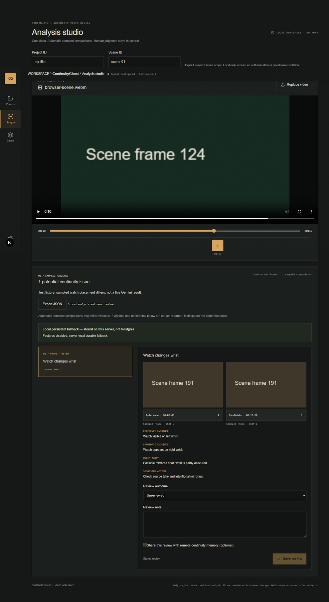
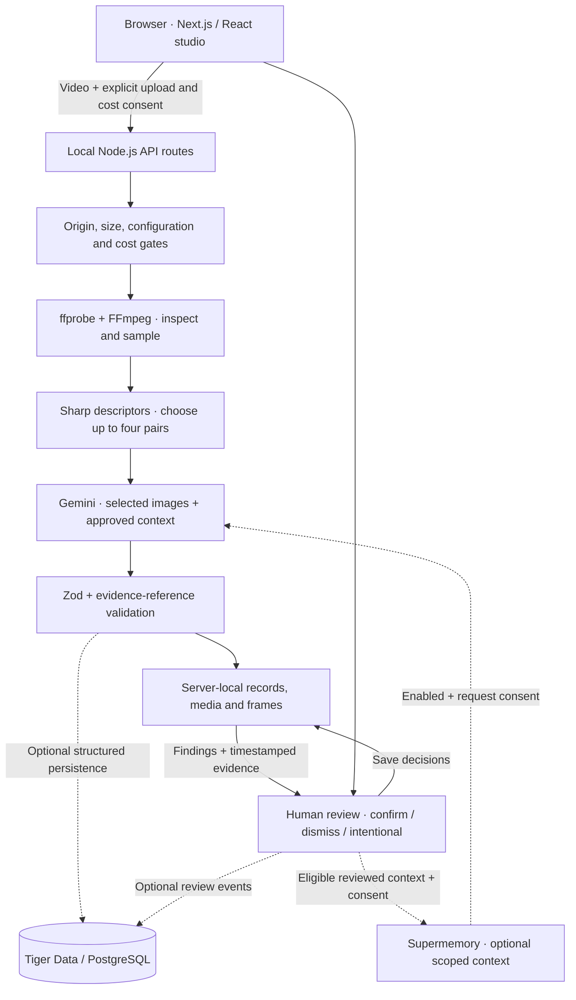
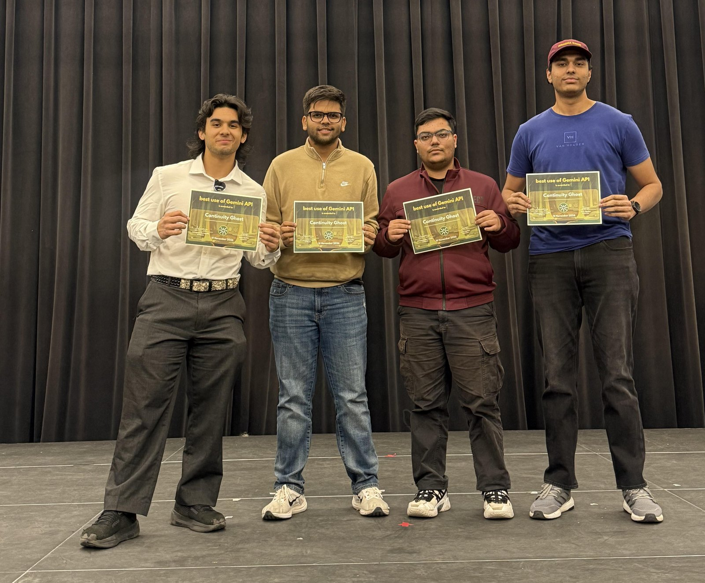

# ContinuityGhost

**AI-powered continuity review for filmmakers.**

**Winner — Best Use of Gemini API | SunHacks 2026**

Awarded November 15, 2026 · Built by a four-person team

[**Watch Demo / Project Video →**](https://www.youtube.com/watch?v=6cv2eZ5ibYQ) · [Award & team](#sunhacks-2026-award) · [Architecture](docs/ARCHITECTURE.md) · [Run locally](#run-locally)

Continuity mistakes can hide between takes: a watch disappears, a prop moves, or wardrobe changes. ContinuityGhost turns a short video into sampled frame comparisons, then uses Gemini to surface potential visual inconsistencies with timestamps and evidence. Filmmakers review each finding and decide whether it is an error, an intentional change, or insufficient evidence—not the model.

## See the project

[](https://www.youtube.com/watch?v=6cv2eZ5ibYQ)

**[Watch the 2-minute project video](https://www.youtube.com/watch?v=6cv2eZ5ibYQ).** Supplied by the team; YouTube lists it as *Demo Video* by Johan Jagalur. Video metadata and availability were checked, but the full demonstration was not independently verified. The video is not evidence of live Gemini output.

[](docs/assets/screenshots/analysis-studio-offline-fixture.jpg)

[Open the app screenshot full-size](docs/assets/screenshots/analysis-studio-offline-fixture.jpg).

*Actual application interface captured by the repository's Playwright suite using browser-generated video and mocked API responses. The watch finding is a labeled test fixture, not a live Gemini result. [Screenshot provenance](docs/assets/README.md).*

## What it does

| Capability | Implemented behavior |
| --- | --- |
| Automatic video analysis | Upload one 15–60-second MP4, WebM, or MOV, up to 64 MiB. FFmpeg samples frames; local heuristics select comparisons without manual frame picking. |
| Semantic visual review | Gemini receives selected frame pairs plus approved context—not the full uploaded video—to suggest potential continuity issues. |
| Traceable evidence | Findings link to sampled timestamps, reference/candidate images, uncertainty, and a suggested follow-up. |
| Human decisions | Mark findings **confirmed**, **dismissed**, or **intentional**; add notes, revisit saved analyses, and export JSON. |
| Durable review history | Server-local storage keeps video analyses, evidence, source media, and saved decisions across reloads. Optional PostgreSQL mirrors structured records and review history. |
| Consent-based context | Optional Supermemory retrieval uses project/scene scope; eligible reviewed information can become reusable context only with the relevant consent. |

The current interface centers on **automatic video review**. The earlier `POST /api/analyze` two-still-image endpoint remains available for explicit reference/candidate comparisons; it is not a required step in the video flow. See [API and processing details](docs/AUTOMATIC-VIDEO.md) and [architecture](docs/ARCHITECTURE.md).

## How it works

1. **Inspect locally.** Validate upload limits and permissions; ffprobe checks the media, and FFmpeg extracts at most 40 timestamped JPEG samples.
2. **Choose evidence.** Visual descriptors group transitions and rank stable, comparable views. Select at most four pairs/eight unique images for one Gemini generation request.
3. **Ask a bounded question.** Send only selected images, pair identifiers, approved context, and consented memory. Ask for evidence, alternative explanations, and uncertainty; zero findings is valid.
4. **Validate and store.** Validate structured output and pair references before accepting findings. Save source media, extracted evidence, and results locally; optional database storage adds structured history.
5. **Keep the reviewer in control.** Seek to evidence timestamps, inspect both frames, save decisions, and optionally share eligible reviewed context with Supermemory.

## System architecture



For a text-first walkthrough, see [How it works](#how-it-works) above or the [detailed architecture](docs/ARCHITECTURE.md).

**Solid paths:** core local workflow. **Dashed paths:** separately enabled integrations. The browser and API run locally; Gemini and optional Supermemory/PostgreSQL are external services. Local storage is still required when PostgreSQL is enabled. [Storage boundaries and failure behavior](docs/DATABASE.md).

## Engineering decisions

- **Sample first, spend deliberately.** Bounded sampling and comparison selection keep evidence and provider work constrained. Ranking favors stable shot interiors and comparable revisited views rather than merely large pixel changes or long time gaps. Small local residuals help preserve accessory changes during deduplication. This is heuristic selection, not exhaustive scene understanding.
- **Use semantic analysis, not pixel differences alone.** A pixel change may be lighting, motion, or a cut. Gemini can interpret objects and scene relationships in paired images; the prompt asks it to consider mirroring, occlusion, intentional action, and whether views are comparable. Model judgment can still be wrong.
- **Treat findings as reviewable claims.** Pair identifiers tie findings to supplied evidence. Strict output validation rejects unsupported structure; qualitative uncertainty is not a calibrated probability. No automatic confirmation or invented bounding boxes.
- **Separate records from memory.** Relational storage tracks analyses, findings, review events, and analytics. Supermemory retrieves approved contextual facts; it is not the source of truth for review history. Both are optional and have distinct failure/consent behavior.
- **Make permission explicit.** Server cost approval and browser upload/cost consent are independent gates. Memory sharing has its own controls. Cancellation and provider failures do not guarantee a refund; retries require fresh approval.

[Detection-quality rationale and regression cases](docs/DETECTION-QUALITY.md) · [Memory and consent model](docs/MEMORY.md)

## Tech stack

| Technology | Role in this repository |
| --- | --- |
| Next.js 16, React 19, TypeScript | App Router interface, Node.js API routes, typed evidence/review contracts |
| Google Gemini API · `@google/genai` | One structured multimodal generation request over automatically selected images; configurable model, currently defaulting to `gemini-3.6-flash` |
| FFmpeg / ffprobe | Local media probing, bounded frame extraction, timestamps |
| Sharp | Image decoding/normalization and visual descriptors for sampling/comparison selection |
| Zod | Request, model-output, stored-record, and client evidence validation |
| PostgreSQL · `pg` · Tiger Data | Optional structured persistence, review events, scoped analytics; three SQL migrations |
| Supermemory HTTP API | Optional project/scene-scoped contextual recall and approved review-derived memory |
| Tailwind CSS · Lucide | Interface styling and icons |
| Vitest · PGlite · Playwright | Unit/route tests, embedded PostgreSQL-compatible SQL tests, browser workflows with mocked provider responses |

## Verification and observed results

**Offline checks for this documentation pass:** lint, TypeScript typecheck, production build, **227 Vitest tests across 18 files**, **27 Playwright browser tests**, and **16 Python credential-helper tests** passed. No live provider calls or external database writes were made. [Verification scope and commands](docs/VERIFICATION.md).

| Evidence | What it establishes—and what it does not |
| --- | --- |
| Unit and route tests | Validation, gates, selection, errors, and persistence contracts. Provider responses are mocked. |
| Local integration tests | Real synthetic-media FFmpeg extraction, filesystem persistence, and SQL behavior in PGlite. Not a Tiger Data connectivity check. |
| Browser tests | Upload, evidence navigation, review saves/reloads, error handling, and responsive layouts using synthetic video and intercepted API responses. Not live Gemini verification. |
| Historical owner-approved run | Repository records describe a 15-second video, 30 frames, three visual groups, a 0-to-9-second comparison, and a missing-watch finding: HTTP 200 in **11.901 seconds**. Records also describe consented Supermemory ingest/recall and Tiger Data readback. These are earlier observations, not rerun here. |

The recorded timing is **one observed run**, not average latency, an accuracy measurement, or a guarantee. The fixture and historical record do not establish detection performance on real productions. [Recorded run details and limitations](docs/AUTOMATIC-VIDEO.md#verification-labels) · [Integration evidence ledger](docs/INTEGRATION-VERIFICATION.md).

## Run locally

**Local use only. No production authentication. Do not deploy publicly or expose through tunnels.**

Prerequisites: a Node.js version supported by Next.js 16 (20.9+), npm, and `ffmpeg` / `ffprobe` on `PATH`. This documentation pass used Node.js 25.8.1; the repo does not pin a Node version.

```bash
npm ci
npm run dev -- --hostname 127.0.0.1
```

Open **http://127.0.0.1:3000**. The interface can run without credentials; analysis stays blocked. Do not copy over an existing `.env.local`.

For first-time Gemini configuration, `npm run setup:gemini` prompts privately in your terminal and refuses to overwrite existing configuration. It leaves all service gates disabled. Never paste credentials into chat, browser inputs, command arguments, or Git.

A live analysis requires a valid server-only `GEMINI_API_KEY`, an available `GEMINI_MODEL`, owner approval before setting `ALLOW_PAID_ANALYSIS=true`, a server restart, and separate browser approval for upload and potential cost. Optional integrations require their own keys, enable flags, and applicable consent. **Do not run `npm run db:migrate` without approval to change the target database.**

[Full setup and safety gates](docs/SETUP.md) · [Private optional-service configuration](docs/CREDENTIAL-SETUP.md) · [Honest demo procedure](docs/DEMO.md)

## Limitations, security, and privacy

- **Sampled evidence only.** Supported clips are short and bounded; subtle, unsampled, occluded, or semantically ambiguous details can be missed or misclassified. Human interpretation remains necessary.
- **Not a hosted multi-user service.** No authentication or private-user isolation. Project/scene labels scope records but are not authorization. Same-origin checks are not authentication.
- **Media persists locally.** Successful video analyses retain source media, frames, and records by default under gitignored `.continuityghost/videos/`. Custom `CONTINUITY_DATA_DIR` locations need equivalent access and Git-exclusion controls. There is no implemented retention/deletion policy. Use only footage and context you have permission to process.
- **External services have separate privacy and cost boundaries.** Google receives selected images/context, not the complete video. Optional memory shares eligible facts, not raw frames. Provider retention is separate from local storage. Never commit credentials or private footage.
- **Historical database TLS exception is not production-safe.** An owner-approved hackathon database used encrypted TLS 1.3 with certificate verification skipped for that URL. Restore verified TLS before any production consideration; do not copy or broaden the exception. [Database caveats](docs/DATABASE.md).

[Detailed security boundaries](docs/SECURITY.md).

## SunHacks 2026 award

**Winner — Best Use of Gemini API | SunHacks 2026**

ContinuityGhost's **four-person team** received this category award on **November 15, 2026**. This is a team achievement—not an overall hackathon win. The supplied certificate names the winning project as “Continuity Ghost.”



[View the award certificate](docs/assets/awards/sunhacks-2026-gemini-certificate.jpg) · [Alternate team photo](docs/assets/awards/sunhacks-2026-winning-team.jpg)

## Engineering documentation

| Start here | Details |
| --- | --- |
| [Architecture](docs/ARCHITECTURE.md) · [Automatic video](docs/AUTOMATIC-VIDEO.md) | Current pipeline, legacy still-image path, API limits, recorded runs |
| [Setup](docs/SETUP.md) · [Security](docs/SECURITY.md) · [Demo](docs/DEMO.md) | Configuration, consent/cost gates, safe local walkthrough |
| [Database](docs/DATABASE.md) · [Memory](docs/MEMORY.md) | Durable records, optional integrations, consent and failure handling |
| [Verification](docs/VERIFICATION.md) · [Integration ledger](docs/INTEGRATION-VERIFICATION.md) | Fresh offline checks versus historical live observations |
| [PRD](docs/PRD.md) · [Status](docs/TASKS.md) · [Sponsor research](docs/SPONSORS.md) | Product scope, deferred work, historical compatibility research |

**Project links:** [Source](https://github.com/palash17sanghvi/continuityghost) · [Project video](https://www.youtube.com/watch?v=6cv2eZ5ibYQ) · [Award evidence](docs/assets/awards/sunhacks-2026-gemini-certificate.jpg)
